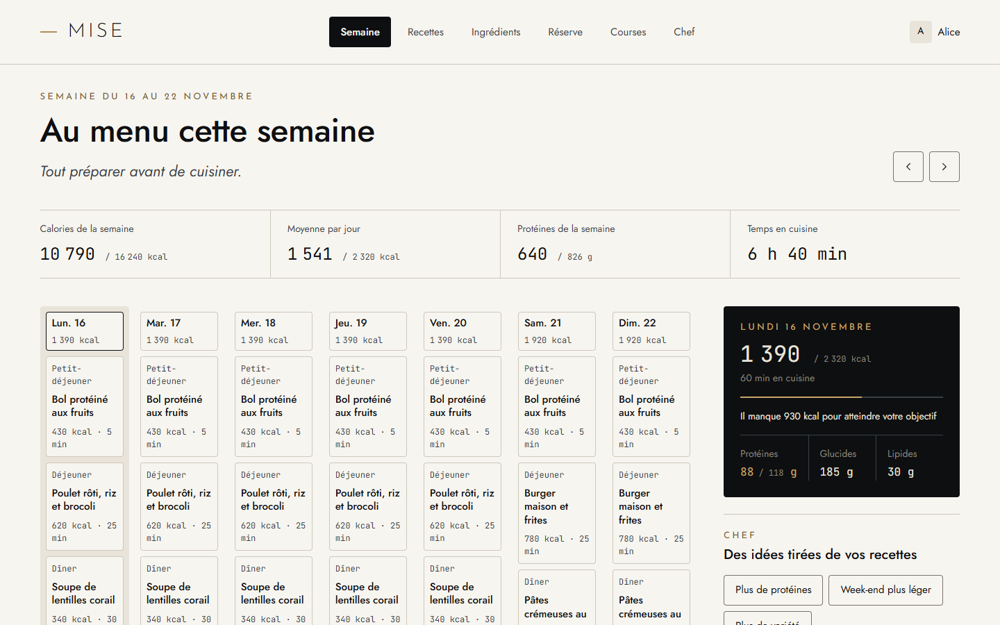
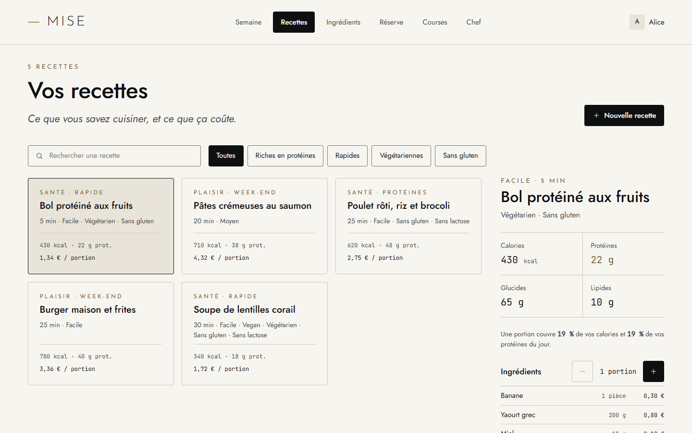
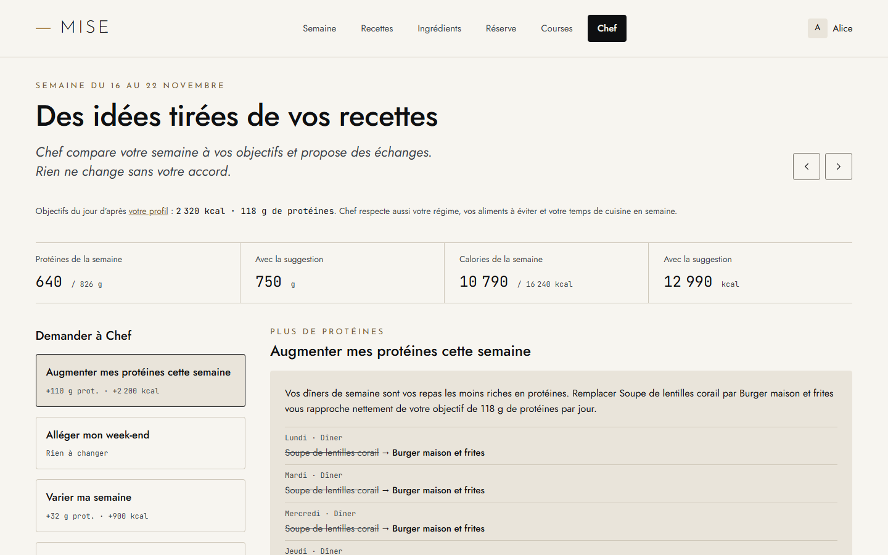
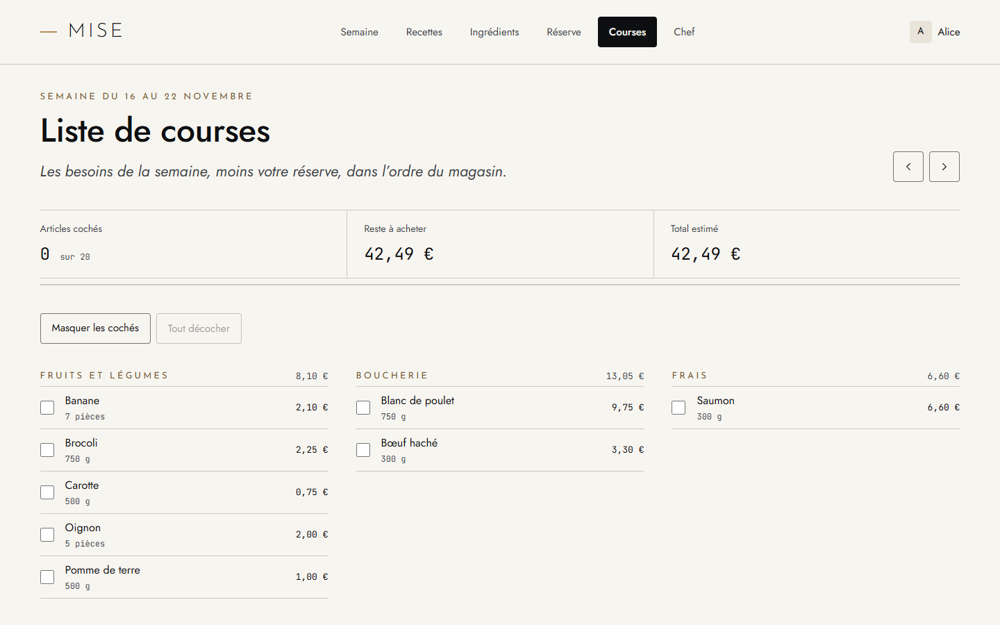
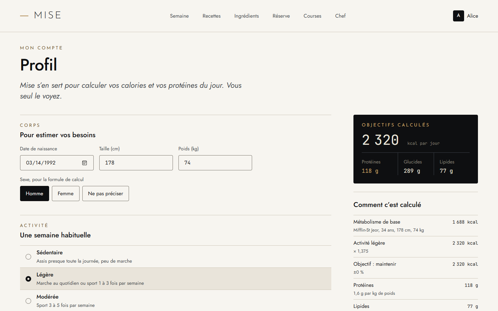
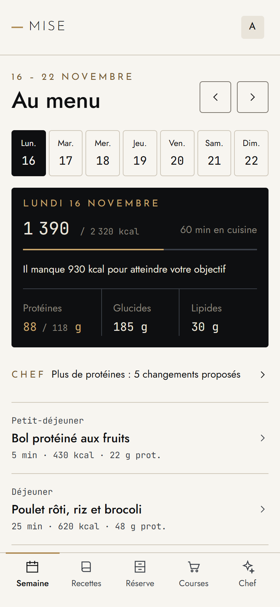
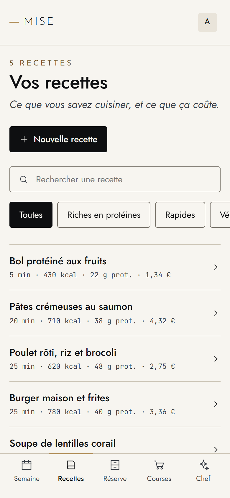
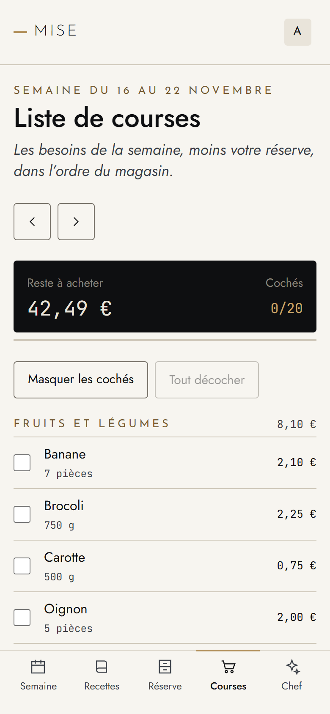
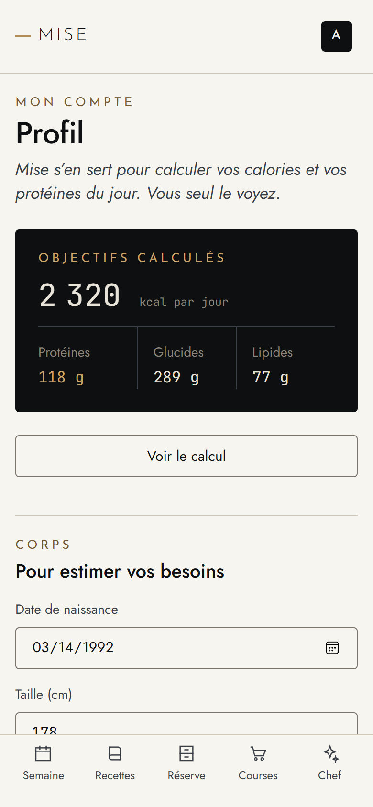

<div align="center">

# — MISE

**Plan the week before you cook.**

A self-hosted meal planner for a household: weekly menus, recipes with their cost,
a pantry that knows what you already have, a shopping list in store order, and
daily nutrition targets that a built-in assistant helps you reach.


[](LICENSE)



</div>

> *Mise* comes from **mise en place**: everything prepared before you start
> cooking. The interface is in French.

## Contents

- [Features](#features)
- [Screenshots](#screenshots)
- [Tech stack](#tech-stack)
- [Architecture](#architecture)
- [Getting started](#getting-started)
- [Accounts and security](#accounts-and-security)
- [Testing](#testing)
- [Deployment](#deployment)
- [Design](#design)
- [Roadmap](#roadmap)
- [License](#license)

## Features

**Plan the week**
- A 7-day board with breakfast, lunch and dinner; change a meal or its portions in two clicks.
- Daily and weekly totals of calories, protein, carbs, fat and cooking time.
- Each day measured against your own targets ("930 kcal short of your target").
- A new week starts as a copy of the previous one.

**Recipes and ingredients**
- Recipes with nutrition per serving, diet labels, tags and a cost per portion.
- An ingredient catalogue priced per kilo, litre or piece, grouped by store aisle.
- Search and filters: high protein, quick, vegetarian, gluten-free.

**Pantry and shopping**
- A pantry ("Réserve") that shows, for every ingredient, whether it covers the week or how much is missing.
- A shopping list built from the week's plan minus the pantry, in store-walk order, with subtotals per aisle, ticking that is remembered per week, and the estimated total.

**Profile and targets**
- Body, activity level, goal and pace give daily targets (Mifflin-St Jeor, activity factor, protein per kg of body weight), with every step of the calculation shown.
- Manual targets override any calculated value.
- Diet, allergies and foods to avoid, weekday cooking-time limit, weekly budget.

**Chef, the assistant**
- Suggests swaps from your own recipes: more protein, a lighter weekend, more variety, what you can cook with your pantry.
- Aims at your targets and respects your diet, foods to avoid and weekday time limit.
- Shows the impact before you apply anything; one click to apply, one to undo.
- Rule-based today, behind a `ChefAdvisor` interface ready for an LLM-backed advisor.

**A household, not a single user**
- Accounts created by the family admin; no public sign-up.
- Everyone's recipes, plans, pantry and profile stay their own.

## Screenshots

| Recipes | Chef |
| --- | --- |
|  |  |
| **Shopping list** | **Profile and targets** |
|  |  |

On a phone, the same screens with a tab bar:

| Week | Recipes | Shopping | Profile |
| --- | --- | --- | --- |
|  |  |  |  |

*Screenshots use a test account and the starter data.*

## Tech stack

| Layer | Choice |
| --- | --- |
| Framework | [Nuxt 4](https://nuxt.com) (Vue 3.5, Nitro server, server-side rendering) |
| State | [Pinia](https://pinia.vuejs.org) setup stores |
| Database | PostgreSQL with [Drizzle ORM](https://orm.drizzle.team) and versioned SQL migrations |
| Validation | [Zod 4](https://zod.dev) on every API input |
| Auth | [nuxt-auth-utils](https://github.com/atinux/nuxt-auth-utils) sealed sessions, scrypt password hashes |
| Language | TypeScript, `strict` |
| Tests | [Vitest](https://vitest.dev) and [@nuxt/test-utils](https://nuxt.com/docs/getting-started/testing) |
| Runtime | Docker (multi-stage image, non-root), Node 24 |

## Architecture

```
app/          Vue front end: pages, layouts, components, Pinia stores, composables
server/
  api/        Thin HTTP handlers: validate input, call a service, return the result
  services/   Business logic, always scoped to the logged-in user
    chef/     ChefAdvisor interface and the rule-based advisor
  db/         Drizzle schema, migrations and starter data
  middleware/ Session check on every /api route
  utils/      Config, database connection, validation, hashing, rate limiting
shared/       Types and pure functions used by both sides (nutrition, targets,
              shopping list, units, French labels and formats)
scripts/      Database creation, migrations, account creation
test/         unit/, nuxt/ (components and stores), integration/ (services, API)
```

- **One source of truth for calculations.** Nutrition totals, targets and the shopping list are pure functions in `shared/`, used by the server and the pages and unit-tested on their own.
- **Data isolation in the service layer.** Every service takes the user's id and filters on it; the integration tests prove that one account can neither read nor change another's data.
- **Pluggable assistant.** Chef's suggestions come from a `ChefAdvisor`; the API and screens don't depend on how suggestions are produced.
- **Codes in the database, French on screen.** Shelves, diets and tags are stored as stable codes and translated for display, so data and matching rules never depend on wording.

## Getting started

### Requirements

- Docker Desktop (recommended), or Node.js 24
- A PostgreSQL server reachable from your machine, or the bundled one (see below)

### Configuration

```bash
cp .env.example .env   # then fill it in
```

Every variable is documented in [`.env.example`](.env.example). `.env` is never committed
and never copied into an image.

### Run with Docker

```bash
npm run docker:up      # build, migrate and start → http://localhost:3000
npm run docker:logs    # follow the app's logs
npm run docker:down    # stop
```

`docker compose up` first runs a one-off `db-setup` service that creates the database if
needed and applies the migrations, then starts the dev server with live reload (your files
are mounted into the container). Inside the containers `POSTGRES_HOST` points to
`host.docker.internal`.

No PostgreSQL server? Set a free `POSTGRES_PORT` in `.env` and start the bundled one:

```bash
docker compose --profile local-db up -d
```

### Run without Docker

```bash
npm install
npm run db:setup       # create the database and apply migrations
npm run dev            # http://localhost:3000
```

### Create the first account

Nobody can sign up: create the admin once from a terminal. It asks for an email, a first
name and a password (typed hidden, stored only as a hash):

```bash
npm run docker:user:create -- --admin   # with Docker
npm run user:create -- --admin          # without Docker
```

Then log in and add the rest of the household from **Famille**.

## Accounts and security

- **Invitation only.** The admin creates each account; a temporary password is shown once and must be replaced at first login. The admin can reset a password or disable an account, but never sees anyone's meals or profile.
- **Sessions.** Sealed, HTTP-only cookies valid for 30 days. Changing or resetting a password, or disabling an account, ends the other sessions.
- **Passwords.** scrypt hashes, 12 characters minimum.
- **Brute force.** 5 failed logins lock an email for 15 minutes; failures are also counted per client address. Unknown emails and wrong passwords give the same answer and take the same time.
- **Isolation.** Every API route requires a valid session, every query is scoped to its user, and admin routes check the role on the server.

## Testing

```bash
npm run typecheck
npm test                    # unit + Nuxt component and store tests
npm run test:integration    # services, accounts, migrations and API on a real database
npm run test:all            # everything
```

The integration tests run against `POSTGRES_TEST_DB`, which they wipe and rebuild on every
run: never point it at real data. They start a production build of the app and cover login,
temporary passwords, session expiry, admin rights, rate limiting and isolation between
accounts.

To change the database schema, edit `server/db/schema.ts`, then:

```bash
npm run db:generate   # writes a migration to server/db/migrations
npm run db:migrate
```

## Deployment

```bash
npm run docker:build:prod   # builds mise:latest
docker run --env-file .env -e POSTGRES_HOST=host.docker.internal \
  --add-host host.docker.internal:host-gateway -p 3000:3000 mise:latest
```

The production image contains only the built server and runs as the `node` user. Apply the
migrations (`db-setup`) before starting it on a new database. Before opening it beyond your
own machine:

- set `NUXT_APP_SECRET` (at least 32 characters, e.g. `openssl rand -base64 32`): the server
  refuses to start without it;
- serve it over HTTPS so session cookies stay secure. On a trusted home network over plain
  HTTP, set `NUXT_SESSION_COOKIE_SECURE=false` instead;
- behind a reverse proxy, every request comes from the proxy's address, so the per-email login
  limit is the one that really applies.

## Design

The interface follows the **Mael Belliard** design system: stone and limestone surfaces, ink
text and brass accents; Jost for text, Josefin Sans for titles and eyebrows, JetBrains Mono
for every figure; thin rules instead of boxes, corners of 4 px at most, no shadows or
gradients. Every screen works on a phone, with a tab bar and bottom sheets.

## Roadmap

Planned next steps are tracked in [NEXT_STEPS.md](NEXT_STEPS.md): a dark theme, and a Chef
advisor backed by the Claude API.

## License

[MIT](LICENSE) © 2026 Mael Belliard
